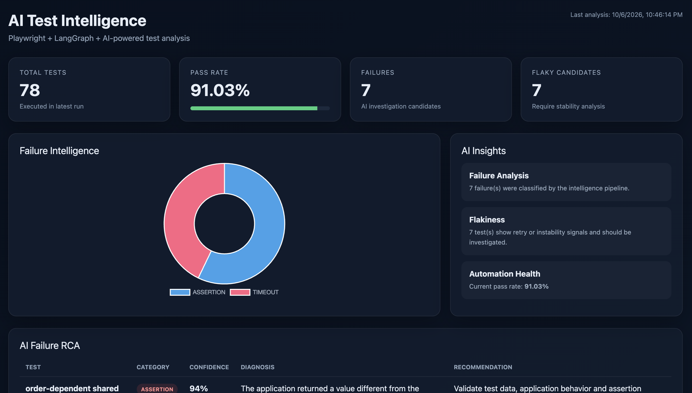

# PlaywrightScripting

**AI-orchestrated end-to-end test automation with Playwright, TypeScript, and LangGraph.**


[](https://github.com/CoderAbb/PlaywrightScripting/actions/workflows/flaky-detection.yml)
[](https://github.com/CoderAbb/PlaywrightScripting/actions/workflows/github-code-scanning/codeql)




Started as a straightforward Playwright + TypeScript automation project and has grown into a
self-healing test framework: it runs your suite, classifies *why* each test failed, auto-fixes
what's safe to auto-fix, and flags what isn't — with a live dashboard showing the full picture.

---

## What this is

✔ Playwright Test Runner with TypeScript, cross-browser (Chromium, Firefox, WebKit)
✔ Structured test flows (login → shop → cart → checkout) with modern selectors (`getByRole`, `getByTestId`, `getByText`)
✔ **AI-powered failure triage** — every failure is classified (timeout vs. assertion) and diagnosed with a confidence score and a recommendation
✔ **Self-healing CI** — syntax/type errors and broken locators are auto-fixed and verified; genuine behavior regressions are never auto-fixed, only flagged for human review
✔ **Flaky test detection** — tests that fail then pass on retry are surfaced as flaky candidates, not silently ignored
✔ **AI Test Intelligence dashboard** — pass rate, failure breakdown, RCA table, and flaky candidates in one view
✔ CI integration for both GitHub Actions and Jenkins
✔ HTML reports, Allure reporting, and full trace viewer support

---

## How the self-healing pipeline works

Three categories of "broken," three different responses:

| Failure type | Example | What happens |
|---|---|---|
| **Syntax / type error** | A `.ts`/`.mjs` file doesn't compile | Auto-fixed by `auto-heal.mjs`, re-verified, before tests even run |
| **Locator-class failure** | `locator.click: Timeout 10000ms exceeded` | Auto-fixed by `heal-locators.mjs` using a role → testid → label → text priority ladder, then the spec is re-run to confirm the fix actually works |
| **Assertion-class failure** | App returned a value different from what the test expected | **Never auto-fixed.** This might mean the app's behavior genuinely changed — "fixing" the assertion could silently hide a real regression. Instead it's written to a `reports/needs-human-review-*.md` file for manual review |

The LangGraph runner in `graph/automationGraph.mjs` coordinates the existing healing scripts without
reimplementing them.

---

## Project Structure

```
PlaywrightScripting/
├── tests/
│   ├── fixtures.ts
│   ├── global-setup.ts
│   ├── login-agent.test.mjs
│   └── specs/
│       └── *.spec.ts
├── pages/                         # Page objects
├── config/
│   ├── testData.ts                # Shared test data
│   └── urls.ts                    # Site URLs
├── scripts/
│   ├── auto-heal.mjs
│   ├── heal-locators.mjs
│   ├── detect-flaky-tests.mjs
│   ├── analyze-results.mjs
│   └── lib/                       # Shared automation and flaky-test utilities
├── graph/                         # LangGraph automation and analysis
├── .github/workflows/             # GitHub Actions workflows
├── jenkins-agent/                 # Jenkins agent config
├── jenkins-config.xml
├── login-agent.mjs
├── login-agent.ts
├── playwright.config.ts
├── tsconfig.json
├── package.json
└── README.md
```

---

## Installation

Requires Node.js 18+.

```bash
git clone https://github.com/CoderAbb/PlaywrightScripting.git
cd PlaywrightScripting
npm install
npx playwright install
```

For the AI-powered scripts (auto-heal, heal-locators, RCA analysis), set an Anthropic API key:

```bash
export ANTHROPIC_API_KEY=sk-...
```

---

## Running Tests

```bash
npx playwright test                          # full suite
npx playwright test --headed                  # headed mode
npx playwright test tests/specs/checkout.spec.ts # a specific spec
```

## Running the self-healing orchestrator

```bash
npm run orchestrate           # run the LangGraph healing workflow
npm run orchestrate:pr        # allow healing scripts to open pull requests
```

Individual pieces can also be run on their own:

```bash
npm run heal:detect           # syntax check only, no API key needed
npm run heal                  # auto-fix syntax/type errors
npm run heal-locators:dry-run # preview locator fixes without applying
npm run heal-locators         # fix + verify locator failures
npm run flaky                 # detect flaky candidates (needs --retries on the run that fed it)
npm run intelligence          # analyze + render the dashboard
```

## Dashboard & Reports

```bash
npm run dashboard             # render the AI Test Intelligence dashboard
npx playwright show-report    # standard Playwright HTML report
npx playwright test --trace on && npx playwright show-trace trace.zip
```

The dashboard shows total tests, pass rate, and AI-generated failure diagnoses with category,
confidence, and recommendations. Its **Recommended Next Steps** section groups failures by type,
explains whether auto-heal is appropriate, and provides copyable commands to preview safe locator
repairs or inspect failures that need manual review. Assertion mismatches are never recommended
for auto-healing. Flaky candidates are listed separately for stability follow-up.

---

## Recommended VS Code Extensions

- Playwright Test for VS Code
- ESLint
- Prettier

---

## Roadmap

- [ ] Quarantine tests that stay flaky across N consecutive runs instead of re-healing every time
- [ ] Wire the dashboard's "Investigate" action to open the relevant trace file
- [ ] Persist flaky/failure history across runs for trend tracking
