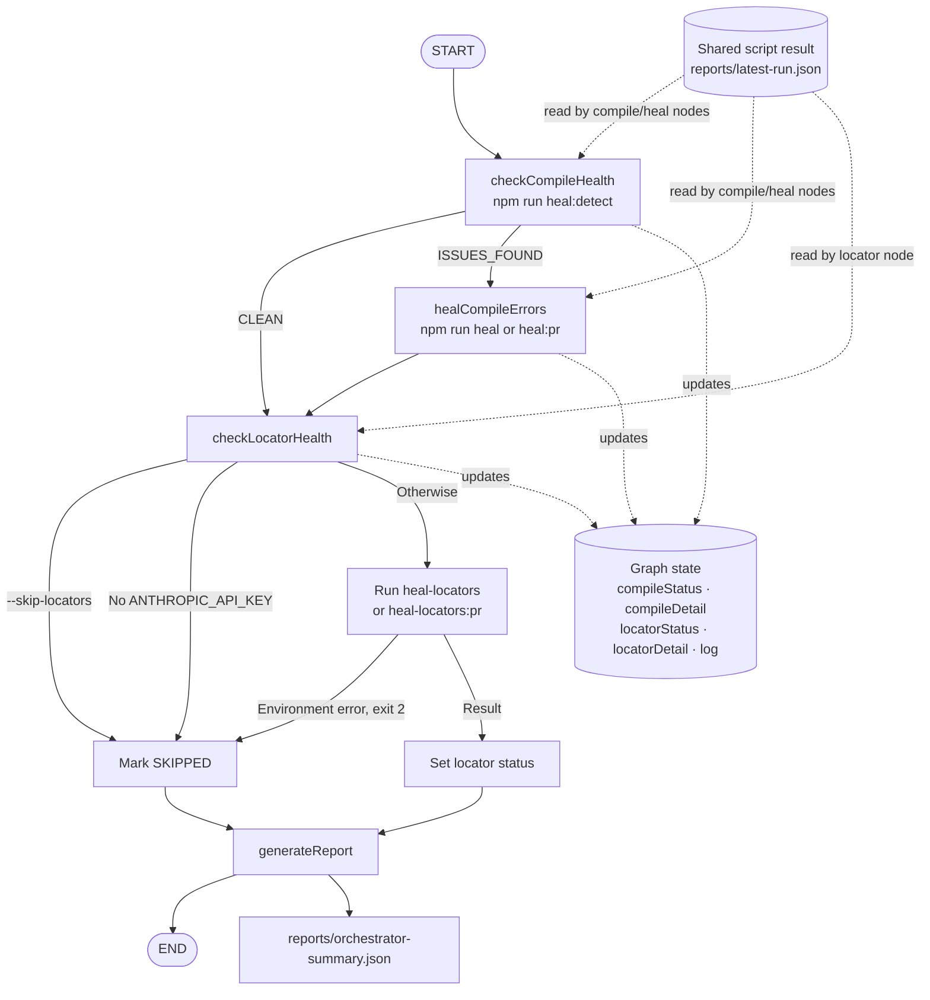
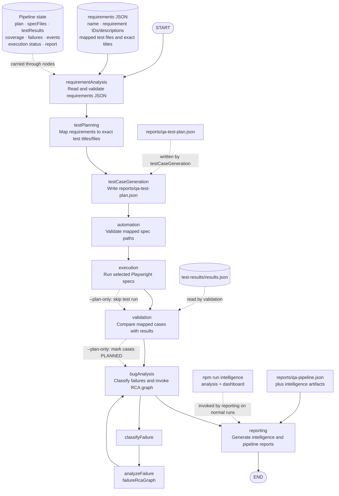

# AI-Augmented Playwright Quality Engineering

## Proposed Target Architecture

This overview presents the repository's quality-engineering direction. The implementation flow below reflects the LangGraph workflows currently in `graph/`; it distinguishes implemented behavior from ideas in the broader target architecture.

## Implementation: LangGraph Workflows

The repository currently has two orchestration workflows with different purposes:

- `graph/automationGraph.mjs` coordinates compile/syntax detection and locator healing.
- `graph/qaPipeline.mjs` maps requirements to existing Playwright tests, runs and validates them, analyzes failures, and reports results.

### Self-healing orchestrator (`automationGraph.mjs`)

The orchestrator routes existing scripts rather than reimplementing their healing behavior. Compile issues take the compile-healing path before locator handling; a clean compile check goes directly to locator handling. `--skip-locators` and a missing API key skip locator healing. The workflow writes a summary report and does not contain a retry loop.

### Requirements-to-report pipeline (`qaPipeline.mjs`)

The diagram shows the main graph edges and the RCA subgraph invoked inside `bugAnalysis`. The plan-only mode is handled within execution, validation, and reporting nodes; it does not add conditional graph-routing edges. The pipeline maps requirements only to existing tests—it validates the mapped paths and exact titles rather than generating new assertions or modifying specs.

## State and failure handling

| Workflow | State passed between nodes | Notable outcomes |
|---|---|---|
| Self-healing orchestrator | Compile and locator statuses/details, plus an accumulated log | Compile issues may be healed; locator healing can be skipped; final status and summary are written to `reports/orchestrator-summary.json`. |
| Requirements pipeline | Requirements, test plan, spec files, execution results, coverage, failures, stage events, and report | Coverage is classified per mapped case; failed executions are classified and diagnosed; reports are written under `reports/`. |
| Failure RCA subgraph | Test, classification, diagnosis, recommendation | Handles locator, timeout, assertion, and network categories with a recommendation for review. |

Assertion failures are diagnosed and recommended for investigation by the RCA flow; the architecture does not imply they are automatically repaired. The broader quality-intelligence concepts in the repository overview should not be read as additional nodes in these two workflows.

## Related implementation

- [`graph/automationGraph.mjs`](../../graph/automationGraph.mjs)
- [`graph/qaPipeline.mjs`](../../graph/qaPipeline.mjs)
- [`graph/failureRcaAgent.mjs`](../../graph/failureRcaAgent.mjs)
- [`graph/flakyTestAgent.mjs`](../../graph/flakyTestAgent.mjs)
